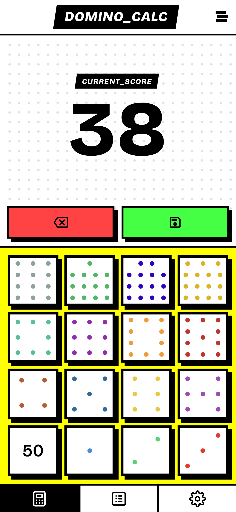
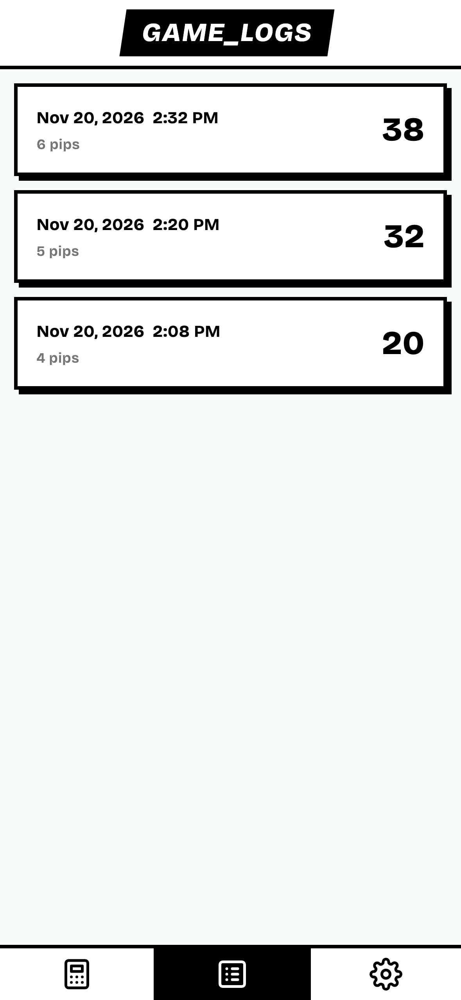
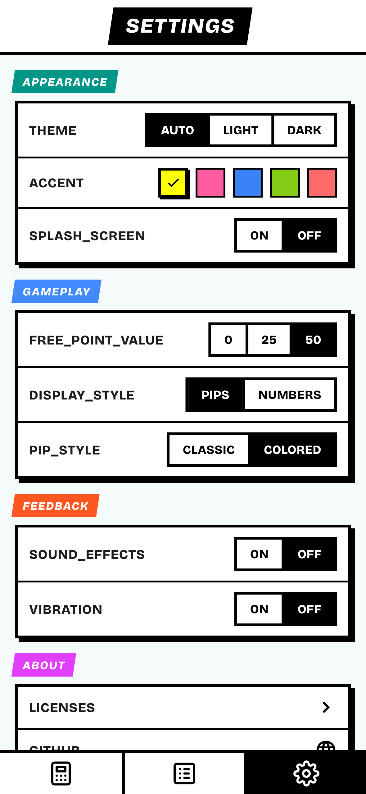
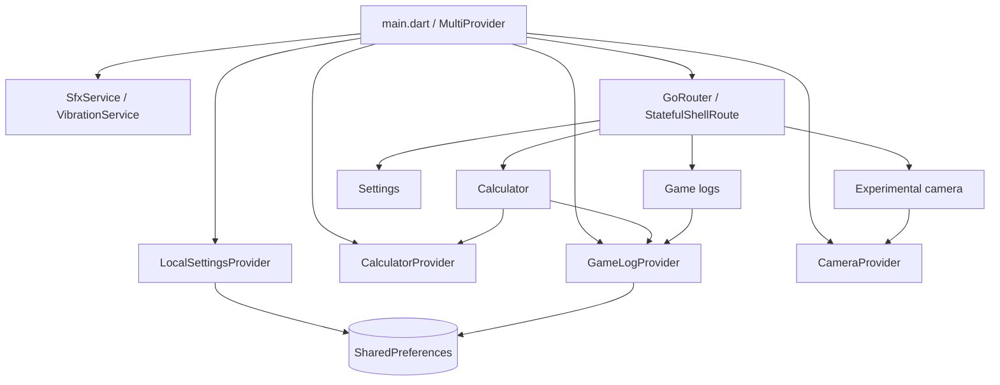

# Domino Counter

A Flutter domino score calculator for iPhone, iPad, and Android. Version 2 pairs a bold brutalist interface with saved game logs, customizable scoring, and sound and haptic feedback.

Tap pip values from 0–15, review your entries, and save the total for later. Settings and saved scores stay on your device.

## Contents

- [Features](#features)
- [Screenshots and design](#screenshots-and-design)
- [Getting started](#getting-started)
- [Scoring and saved games](#scoring-and-saved-games)
- [Settings](#settings)
- [Architecture](#architecture)
- [Project structure](#project-structure)
- [Camera and machine learning](#camera-and-machine-learning)
- [Development and releases](#development-and-releases)

## Features

- **Double-15 scoring:** a 4×4 keypad covers every pip value from 0 to 15, with a live total.
- **Flexible blank scoring:** choose 0, 25, or 50 points for each blank half; the default is 50.
- **Entry review:** inspect the current pip history and remove individual entries. Tap the backspace button to undo the latest entry, or hold it through the 1.5-second fill animation to clear the score.
- **Saved game logs:** save a score with its timestamp, pip entries, and blank-value rule. Open a log to review its breakdown or delete it.
- **Personalized appearance:** system, light, or dark themes; five accent colors; classic or colored pip artwork; and pips or numeric labels.
- **Interaction feedback:** bundled Cuelume sound effects and haptics on supported hardware. Settings show device sound status, and the vibration preference appears only when the device supports it.
- **Adaptive iPad layouts:** larger windows show the calculator, entry history, and keypad together; logs use a list and detail layout; settings use two columns. Smaller windows return to the compact layout.
- **Refreshed branding:** matching launcher icons, native launch screens, and an optional animated splash screen.

## Screenshots and design

| Calculator | Saved games | Settings |
|---|---|---|
|  |  |  |

The interface uses hard shadows, thick borders, sharp corners, skewed headers, SVG pip artwork, and Bricolage Grotesque typography. Light and dark palettes are defined in [NeoBrutalistTheme](lib/theme/neo_brutalist_theme.dart).

Larger layouts activate when the available window is at least 700 logical pixels wide and 620 high. Navigation moves from the bottom bar into the app bar in these workspaces.

See [iPad design references](design/ipad/), [branding assets](assets/branding/), and [store screenshots and campaign artwork](store-assets/v2/).

## Getting started

### Prerequisites

- **Flutter 3.50.1** to match the version pinned in CI. The Dart SDK constraint is `^3.10.3`; Dart is included with Flutter.
- An iOS simulator, Android emulator, or physical device.
- For iOS development, macOS with Xcode and CocoaPods. The release workflow pins **Xcode 27.2** and requires **iOS SDK 27 or newer**.
- For Android builds, **JDK 21** to match CI.

### Run locally

```bash
git clone https://github.com/chrisstayte/DominoesCalculator.git
cd DominoesCalculator
git switch dev
flutter pub get
flutter run
```

### Analyze and test

```bash
flutter analyze --no-fatal-infos
flutter test
```

Tests cover scoring, settings and log persistence, malformed stored data, screen interactions, sound assets, camera state, and iPad window layouts.

### Build for local use

```bash
# iOS simulator
flutter build ios --simulator

# Android debug APK
flutter build apk --debug
```

For signed store builds, use the [release workflow](#development-and-releases) and follow [RELEASING.md](RELEASING.md).

## Scoring and saved games

Each keypad tap adds one domino half to the current entry list. Values 1–15 contribute their pip count; 0 contributes the configured blank value. For example, `5 + 3 + blank` totals **58** with the default 50-point blank rule.

The keypad keeps the highest values at the top:

```text
12  13  14  15
 8   9  10  11
 4   5   6   7
 0   1   2   3
```

Saving requires at least one entry. It records the total, entries, timestamp, and blank value, then clears the calculator for the next score. Changing the blank rule later does not change previously saved totals.

The current calculator entries live in memory. Saved game logs and preferences persist through SharedPreferences as JSON under `gameLogs` and `localSettings`. Loading falls back to default settings or removes malformed log records so damaged local data does not prevent startup.

## Settings

| Preference | Choices | Default |
|---|---|---|
| Theme | System, light, dark | System |
| Accent | Yellow, pink, blue, lime, coral | Yellow |
| Splash screen | On / off | On |
| Blank value | 0, 25, 50 | 50 |
| Display style | Pips / numbers | Pips |
| Pip style | Classic / colored | Classic |
| Sound effects | On / off | On |
| Vibration | On / off, on supported hardware | On |

Sound effects respect iOS Silent Mode and use Android's system sonification audio settings. When sound effects are enabled, the settings screen displays notices for silent mode, vibrate mode, or muted volume as reported by the platform.

The experimental camera screen also has persisted confidence-label and scan-line preferences, defaulting to off and on respectively. The Settings screen includes app version information and third-party licenses, including the [Cuelume sound license](assets/sfx/Cuelume-LICENSE.txt).

## Architecture

The app uses **Provider / ChangeNotifier** for state, **GoRouter** for navigation, and **SharedPreferences** for local persistence.



| Component | Responsibility |
|---|---|
| `CalculatorProvider` | Current entries, individual removal, undo, clear, and computed totals |
| `GameLogProvider` | Load, save, and delete game logs while retaining each game's scoring rule |
| `LocalSettingsProvider` | Load and persist appearance, gameplay, feedback, and camera preferences |
| `CameraProvider` | Camera permissions, preview lifecycle, capture, and prototype inference |
| `SfxService` | Low-latency playback of bundled interaction sounds |
| `VibrationService` | Hardware support checks and preference-aware haptic feedback |

The router starts at `/calc`, with branches for `/logs`, `/camera`, and `/settings`. `StatefulShellRoute.indexedStack` retains each branch's navigation state. Camera navigation is hidden unless its build flag is enabled.

## Project structure

```text
lib/
├── main.dart                 # Startup, providers, themes, splash, licenses
├── router.dart               # Stateful tab navigation
├── enum/                     # Pip values, display styles, accent colors
├── global/feature_flags.dart # Experimental camera build flag
├── models/                   # Settings, game logs, detection results
├── providers/                # Calculator, logs, settings, camera state
├── screens/                  # Calculator, logs, settings, camera, licenses
├── services/                 # Sound, haptics, image processing, LiteRT
├── theme/                    # Light and dark design tokens
└── widgets/                  # Adaptive workspaces and shared UI
assets/
├── branding/                 # Launcher icon source assets
├── images/                   # Pip SVGs, navigation icons, launch icon
├── models/                   # Bundled prototype SSD model and COCO labels
└── sfx/                      # Interaction sounds and Cuelume license
design/                      # Icon explorations and iPad references
store-assets/v2/              # Store screenshots and campaign artwork
machine_learning/            # Colab notebooks, readable sources, checks
scripts/release/              # Build numbering, signing, validation, uploads
test/                        # Model, provider, screen, and layout tests
.github/workflows/            # Dev checks, mobile release, Play promotion
```

Other key dependencies include `flutter_svg`, `google_fonts`, `audioplayers`, `camera`, and `flutter_litert`. See [pubspec.yaml](pubspec.yaml) for the current app version and dependency constraints.

## Camera and machine learning

Camera scanning is **experimental and disabled by default** through `ENABLE_CAMERA_SCANNING`. To expose the prototype camera tab during development:

```bash
flutter run --dart-define=ENABLE_CAMERA_SCANNING=true
```

The current Flutter implementation uses the bundled `assets/models/ssd_mobilenet_v1.tflite` object detector with COCO labels. The new domino-specific pipeline still needs to be integrated; enabling the prototype tab does not enable automatic domino scoring.

The domino reader is being developed in two standalone Google Colab notebooks:

1. [Domino detector](machine_learning/notebooks/01_domino_detector.ipynb): rotated tile detection with YOLO26 OBB, validation, and mobile export.
2. [Pip classifier](machine_learning/notebooks/02_pip_classifier.ipynb): in-notebook half-tile labeling, 16-class classification for values 0–15, and full-photo score evaluation.

Labeling progress and training checkpoints persist in Google Drive. Labeling can resume without installing the model training packages, and the labeling station uses built-in Colab output controls. Training data and newly exported models are ignored by Git.

Integrating these models into Flutter still requires OBB decoding, tile rectification and splitting, classifier inference, quantization handling, and validation on target devices. See the [Colab setup and dataset guide](machine_learning/docs/ml-pipeline.md) for the data contract, labeling, training, resume, and export steps.

## Development and releases

Integrate changes into **`dev`**. Pushes and pull requests targeting `dev` run Flutter analysis and tests with the pinned SDK. Pull requests targeting `main` additionally validate iOS and Android builds.

Promote reviewed changes from `dev` to **`main`** when preparing a release. Every push to `main` runs checks and validates both signed mobile builds before either store upload, then distributes to **TestFlight** and **Google Play internal testing**.

For a fresh beta build, run **Actions → Mobile release → Run workflow** on `main` and choose `testflight`, `play-internal`, or `both`. The workflow also offers a `validate` mode without uploading. Upload runs reserve a `mobile-vX.Y.Z+N` tag on the reviewed commit before contacting a store, with one shared build number for both destinations. After an ambiguous or partial upload, inspect the stores and dispatch a fresh run with a new build number for the missing destination.

Store credentials belong in the repository's main-only `testflight` and `play-internal` environments. Production publishing is a separate action; Android's **Promote tested Play release to production** workflow reuses a tested internal version code without rebuilding it.

Follow [RELEASING.md](RELEASING.md) for credential setup, build-number seeding, signing, SDK validation, retries, and production promotion.
