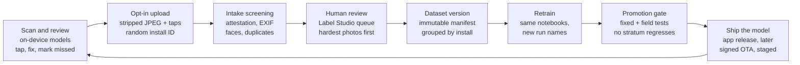

# Domino detection: model and learning plans

November 22, 2026. Research plan for the next generation of the on-device
domino detector and pip classifier. Planning input only; nothing here is
implemented yet.

The models are limited by data, not architecture: 36 training photos from a
narrow set of scenes. Plan 1 fixes that with a measured test set, synthetic
tiles and targeted collection. Plan 2 turns the tap-to-confirm review screen
into an opt-in labeling stream that feeds versioned model updates. The
detector's AGPL licence has to be settled before either ships.

**Status when written:** the app is MIT-licensed. Because the Ultralytics
detector is AGPL-3.0, the camera is removed from the app (no tab, no route, no
provider, `assets/models/` not bundled, no flag or remote switch). The camera
and detection code remain in the repository, dormant. See
[camera review](../../docs/camera-review.md).

## Where things stand

The camera pipeline runs two models on device in a background isolate: a
detector finds rotated tiles, then a classifier reads each half as 0 to 15.
Both are trained from one Label Studio export in Colab.

| Piece | Today | Known weakness |
| --- | --- | --- |
| Detector `domino-v2-01` | YOLO26n-OBB, 640×640, FP32 LiteRT, conf 0.25, rotated NMS 0.7 | Zero detections on both white-background photos; duplicate, shifted and neighbour-crossing boxes on dense grids; false hits on watermark text |
| Classifier `pips-v3-mnv2-mixed-01` | MobileNetV2 α 0.5, ImageNet init, 128×128 halves, 50% grayscale + hue augmentation, FP16 (1.7 MB) | 29/36 selected challenge pairs; undercounts 6 and dense 10 to 15 patterns; depends on clean crops |
| Training data `dominoes-v1` | 36 photos, 821 tile boxes, 1,642 labeled halves | Few physical sets, few backgrounds, one color mapping dominates |
| Evaluation | Frozen group split: 5 validation photos (124 boxes), test unused; 7 ad hoc challenge photos | Validation mAP50 0.995 does not transfer; no exhaustively labeled test set, so recall and total-score accuracy are unmeasured |
| App review | Tap a correct box to confirm it, then add confirmed tiles to the calculator | No way to correct a value or mark a missed tile; nothing is stored or uploaded |

Two consequences shape both plans. First, the 0.995 validation score measures
five photos that look like the training photos, so it cannot tell a better
model from a worse one. Second, the Ultralytics detector is AGPL-3.0, which
blocks shipping it in the MIT app and also affects how models could be
delivered over the air.

## Licensing comes first

**Recommendation: keep the app MIT. Leave the camera out, ask Ultralytics for
an Enterprise quote, and in parallel spike one Apache-2.0 detector.** The
labels, synthetic data and test set from Plan 1 carry over to any detector, so
switching costs engineering time, not the data work.

What the repo uses: the detector is Ultralytics YOLO26n-OBB, fine-tuned from
`yolo26n-obb.pt` with Ultralytics 8.4.144 and exported with its LiteRT
exporter. Ultralytics states that
[all models trained with its code fall under AGPL-3.0](https://www.ultralytics.com/licensing),
even when trained from scratch, unless you hold an Enterprise licence. The pip
classifier (Keras MobileNetV2) is Apache-2.0 and is not a problem.

Adopting AGPL would make the whole app's source AGPL: anyone may copy, rebuild
and republish it, and every user must be offered the source. GPL-family
licences also have a history of friction with App Store terms.

| Option | Licence | Rotated boxes | Phone export | Switching effort |
| --- | --- | --- | --- | --- |
| Ultralytics YOLO26 + [Enterprise licence](https://www.ultralytics.com/licensing) | Commercial, custom quote only | Yes, native OBB | Already working (LiteRT) | None; cost unknown until quoted |
| Ultralytics under AGPL | AGPL-3.0 for the whole app | Yes | Already working | Relicense the app; App Store risk |
| RTMDet-R ([MMRotate](https://arxiv.org/pdf/2204.13317)) | Apache-2.0 code; confirm the pretrained weights' terms | Yes, native | ONNX via [MMDeploy](https://mmdeploy.readthedocs.io/en/1.x/04-supported-codebases/mmrotate.html), then conversion to LiteRT or Core ML | Medium to high; export is the risk |
| [RF-DETR](https://roboflow.com/model-licenses/rf-detr) Nano/Small/Medium | Apache-2.0 (XL and 2XL are under Roboflow's PML) | Not directly; its segmentation masks give a rotated rectangle | ONNX supported | Medium; check the per-size licence table before use |
| [D-FINE](https://github.com/Peterande/D-FINE) / [DEIM](https://github.com/Intellindust-AI-Lab/DEIM) | Reported Apache-2.0; confirm the LICENSE files | No; needs an angle head or corner keypoints | ONNX; phone conversion unproven here | High |
| RT-DETR (original authors' repo) | Apache-2.0; the Ultralytics copy is AGPL | No | ONNX | High |
| YOLOX | Apache-2.0 | No (community rotated forks exist) | ONNX, ncnn, TFLite demos | Medium to high |
| EfficientDet-Lite / SSD (TensorFlow, MediaPipe) | Apache-2.0 | No | Native LiteRT | Low effort, likely lower accuracy |

Rotation matters because each tile is straightened before its pips are read.
An axis-aligned detector needs one extra step to recover the angle:
segmentation masks with a minimum-area rectangle, four corner keypoints, or an
angle regression head. The synthetic renderer in Plan 1 can emit any of these
label formats.

Licence details for the alternatives came from secondary sources during this
research; confirm each project's LICENSE file and weight terms before relying
on it. This is planning input, not legal advice.

## Plan 1: A meaningfully better model

Measure first, then fix the data, then change the models. Every later step is
judged by the test set built in step 1, so it comes before any retraining.

### 1. A test set that can tell models apart

- **Collect 40 to 60 fresh photos that never touch training.** Take them with
  the app's own camera, at real game tables. Group by session so
  near-duplicate shots stay together.
- **Label them exhaustively:** every visible tile box and both half values,
  including tiles the models miss today. Partial labels are why recall and
  total accuracy are unmeasured now.
- **Stratify:** at least one whole physical set held out, white backgrounds,
  dense grids and chains, single close-ups, black-pip and two or more colored
  schemes.
- **Score the pipeline, not the parts:** tile recall and precision at OBB IoU
  0.5, pair accuracy on matched tiles, exact hand-total accuracy, mean absolute
  total error, and the share of auto-confirmable tiles that are actually
  right. Report each stratum separately, never only the average.
- **Run the exported LiteRT files** with the same preprocessing as the Dart
  pipeline (parity is already verified), and save one scorecard JSON per
  candidate in `machine_learning/reviews/`.
- **Promotion gate:** a candidate ships only if hand-total accuracy improves
  and no stratum regresses beyond an agreed tolerance.

### 2. Data: the biggest lever

- **Synthetic tiles, because pip layouts are canonical.** A procedural
  renderer draws tiles 0 to 15 in black and several color mappings, with
  bevels, dividers, wear, perspective, shadows, glare, blur and JPEG noise, on
  random backgrounds including plain white. Boxes and half values come free
  and exact. Pretrain both models on it, then fine-tune on real photos.
- **Copy-paste augmentation from the 821 labeled tiles.** Cut real tiles out
  by their polygons and paste them onto new backgrounds, in touching rows and
  grids. This targets white tables and dense layouts directly.
- **Hard negatives:** photos with no tiles but text, watermarks, dice, cards
  and keyboards. This targets the watermark false detections.
- **Targeted real collection:** 150 to 300 photos in rounds of about 100,
  following the matrix in the [photo-test review](photo-test-review-2026-11-22.md)
  (sets × backgrounds × layouts × lighting × angle). Inspect failures after
  each round before collecting more.
- **Model-assisted labeling:** import current predictions into Label Studio as
  pre-annotations so people correct rather than draw. Nothing is accepted
  without a human check, and predictions never become labels by themselves.
- **Train the classifier on detector crops,** jittered, not only on
  hand-drawn annotation crops. The shifted-box regressions (12/12 on
  annotation crops, 9/12 on detector crops) come from this mismatch.

### 3. Detector changes

- **Higher capture resolution.** At 640 px, tiles in a dense photo are only
  tens of pixels wide. Export a 960 or 1024 capture model and keep a smaller
  one for live preview. Try tiled inference on capture if that is not enough.
- **Compare a nano against a small model** on the capture path, where a second
  of latency is acceptable.
- **Tighten rotated NMS.** IoU 0.7 lets duplicate boxes through. Physical
  tiles rarely overlap much, so sweep 0.3 to 0.5 on the test set.
- **Licensing.** Every detector change in this plan applies to whichever
  detector the licensing section settles on. If it is a permissive one, its
  spike (train on v1 data, export to LiteRT, score on the test set) replaces
  the YOLO-specific steps above.

### 4. Reading the pips

- **Set-aware decoding (cheap win).** Add a "double-6, 9, 12 or 15" setting,
  mask classifier outputs above the set's maximum, and flag duplicate pairs in
  one photo, since each pair exists once per set.
- **Rotation test-time augmentation.** Classify the tile and its 180° turn
  (halves swap) and average. It costs one extra small inference per half.
- **Calibrate confidence** with temperature scaling, so the 0.8 review
  threshold means roughly 80% right and can safely drive pre-selection in the
  review screen.
- **Whole-tile classifier with two heads,** reading 256×128 at once so the
  divider and neighbouring half give context. Use class-balanced sampling for
  the sparse values 10 to 15.
- **Challenger: count pips instead of recognising patterns.** A small point
  detector or density head finds pip centres per half and counts them. It
  should generalise across colors and sets, and synthetic data gives exact pip
  positions. Run it only if the classifier plateaus on the test set.

### 5. On-device performance

- **Measure per stage on real phones** (decode, letterbox, detector, rectify,
  classifier) with p50 and p95, on a recent iPhone and a mid-range Android.
  Desktop timings so far say nothing about phones.
- **Smaller exports:** the detector is 10.1 MB FP32. Try FP16 and INT8
  (calibrated on real photos) and accept them only within the test-set
  tolerance; the export notebooks already compare variants.
- **Hardware delegates:** Core ML or Metal on iOS and GPU on Android, falling
  back to CPU.
- **Batch the classifier:** today it is invoked once per half; one batched
  call per photo cuts overhead on dense photos.
- **Delete the unused 4.2 MB `ssd_mobilenet_v1.tflite`** and COCO labels from
  `assets/models/`; nothing in `lib` or `test` references them.

### 6. Order of work

1. Test set, evaluation script and scorecard for the current models (the baseline).
2. Classifier quick wins: set-aware decoding, rotation averaging, calibration, training on detector crops.
3. Synthetic renderer, copy-paste and hard negatives; pretrain both models and compare.
4. Real collection round 1 with model-assisted labeling; retrain and compare.
5. Detector resolution, size and NMS sweep; quantization and delegates measured on phones.
6. Pip-counting challenger, only if reading accuracy stalls.
7. Licensing decision before any release that includes a detector.

## Plan 2: Users improving the model over time

Every capture ends with a person checking the boxes, so the app produces
labels as a side effect of play. The plan is to collect those, with consent,
have a person verify them, and retrain on a schedule. User taps are hints for
reviewers, never ground truth on their own.

### What the review screen can tell us

| Signal | Available today? | What it is worth | Caveat |
| --- | --- | --- | --- |
| Tapped (confirmed) tile | Yes | Box and both values, very likely right | People confirm in a hurry; a reviewer still checks |
| Readable tile left untapped | Yes | Almost nothing | It may be correct but someone else's tile, so it is not a negative |
| Unreadable tile | Yes | A hard example worth labeling first | Needs full human labeling |
| Wrong values | No (editing was removed) | The most valuable correction | Add an optional long-press "Fix values" that does not slow the tap-to-confirm flow |
| Missed tile | No | The only detector-recall signal | Add "Tap a tile I missed"; a rough tap point is enough for a reviewer |
| Retakes, scans with nothing confirmed | Partly | Field failure rate | Count only, no image |

Anonymous counters per model version (tiles shown, confirmed, unreadable,
retakes) need no photos at all. They should ship first, because they show
whether a new model helps real users.

### Consent and privacy

- **Off by default.** A Settings switch, "Help improve tile scanning", with a
  one-screen explainer of what is sent and why. While it is on, the review
  screen shows a small "Don't share this photo" option.
- **Send only what training needs:** a JPEG downscaled to about 1600 px on the
  long edge with all EXIF (including GPS) stripped, the predicted boxes and
  values, the taps and fixes, model and app version, and a random install ID.
  No account, name or contact data.
- **Upload after review, in the background,** on Wi-Fi by default, with
  retries. Scanning and the calculator never wait on the network.
- **Delete on request:** "Delete my shared photos" removes everything tied to
  the install ID and excludes it from future datasets. Say plainly that models
  already trained are not retrained.
- **Screen on arrival:** server-side face and person detection quarantines
  photos showing people for a reviewer to discard or blur.
- **Paperwork:** update the privacy policy, the App Store privacy label (photos
  collected, not linked to identity, for product improvement) and the Google
  Play data safety form, with consent as the legal basis. Set a retention
  limit, for example two years.

### Backend

A small serverless stack is enough. Cloudflare fits because accounts already
exist there; Firebase (Storage, Firestore, App Check) is the equivalent
alternative.

| Part | Cloudflare service | Job |
| --- | --- | --- |
| Upload API | Worker | Verifies App Attest or Play Integrity, rate-limits by install ID, returns a short-lived signed upload URL |
| Photo store | R2, private bucket | Original uploads, quarantined and approved prefixes |
| Metadata | D1 | Submissions, tiles, user signals, review status, dataset membership, deletions |
| Intake | Queue + Worker | Recheck EXIF, detect faces, remove near-duplicates by perceptual hash, set review priority |
| Labeling | Label Studio with R2 as S3-compatible storage | Reviewers correct pre-filled boxes and values; confirmed tiles start accepted |
| Model files | R2 behind a CDN path | Signed model manifest and model files for over-the-air delivery |

**Review priority** puts first what teaches the model most: unreadable tiles,
value fixes, missed tiles, low-confidence photos, and new sets or color
schemes. Confirmed-only photos from familiar scenes go last. Later, a larger
server-side teacher model can pre-label submissions and flag disagreements
with the phone model.

### Retraining and versioning

- **Immutable dataset versions.** Each export, such as `dominoes-v3`, is v1
  plus reviewed submissions, with a hash manifest. The existing contract and
  frozen-split checks extend to it unchanged.
- **Group by install ID and session,** so one person's photos never straddle
  train and test. Reserve some contributors' photos as a rolling field test
  set beside the fixed Plan 1 test set.
- **Cadence:** retrain after about 200 newly reviewed photos or monthly,
  whichever is later, using the existing notebooks with new run names.
- **Same gate as Plan 1:** the scorecard must beat the current model on both
  test sets, with no stratum regressing.

### Delivering new models

- **First, bundle in the app.** New models ride the existing dev, main,
  TestFlight and Play internal pipeline, with hashes and tensor contracts in
  `assets/models/domino_models.json`. This is simple and reviewable.
- **Later, over the air.** The app reads a signed manifest (model version,
  SHA-256, size, tensor contract, minimum app version, rollout percentage). It
  downloads in the background, checks the signature, hash and contract with
  the existing startup checks, and keeps the bundled model as a fallback.
- **Staged rollout:** 10%, then 50%, then everyone, compared on the anonymous
  confirm rate per model version, with a remote switch back to the bundled
  model.
- **Keep the tensor contract fixed** so an update changes weights only, never
  app code. Over-the-air delivery does not remove licence obligations, so the
  licensing choice comes first.
- **Not federated learning.** At this scale, on-device training adds
  complexity without benefit; central review gives cleaner labels.

### Phases

1. **Internal export, no backend.** A debug-only "Export review" shares the
   photo, predictions and taps as a zip, for testers. It tests the signal
   before any infrastructure exists.
2. **Richer review signals:** "Fix values", "Tap a tile I missed", the
   set-size setting and anonymous counters.
3. **Opt-in upload** with the backend, intake screening and the Label Studio
   review queue.
4. **Scheduled retraining** with the field test set, shipped in app releases.
5. **Over-the-air models** with signed manifests and staged rollout.

## The data loop

A person verifies every label before it trains a model.

Photos only enter the loop when a user has opted in, and nothing reaches
training until a reviewer has checked it. Anonymous confirm rates per model
version close the loop by showing whether a shipped model actually helps.

## Open decisions

1. **Detector licence:** request an Ultralytics Enterprise quote, switch to an
   Apache-2.0 detector, or both in parallel (recommended: both, decide on
   price and spike results).
2. **Test set:** who photographs and labels the 40 to 60 held-out photos, and
   which physical sets to hold out entirely.
3. **Review screen:** whether to bring back an optional "Fix values" and add
   "Tap a tile I missed", since these are the only correction signals.
4. **Data collection:** whether users may share photos at all, and if so, full
   photos or tile crops only (crops are lower risk but cannot teach the
   detector about misses).
5. **Backend home:** Cloudflare (Workers, R2, D1) or Firebase.
6. **Delivery:** stay with models bundled in app releases, or plan for
   over-the-air updates later.
